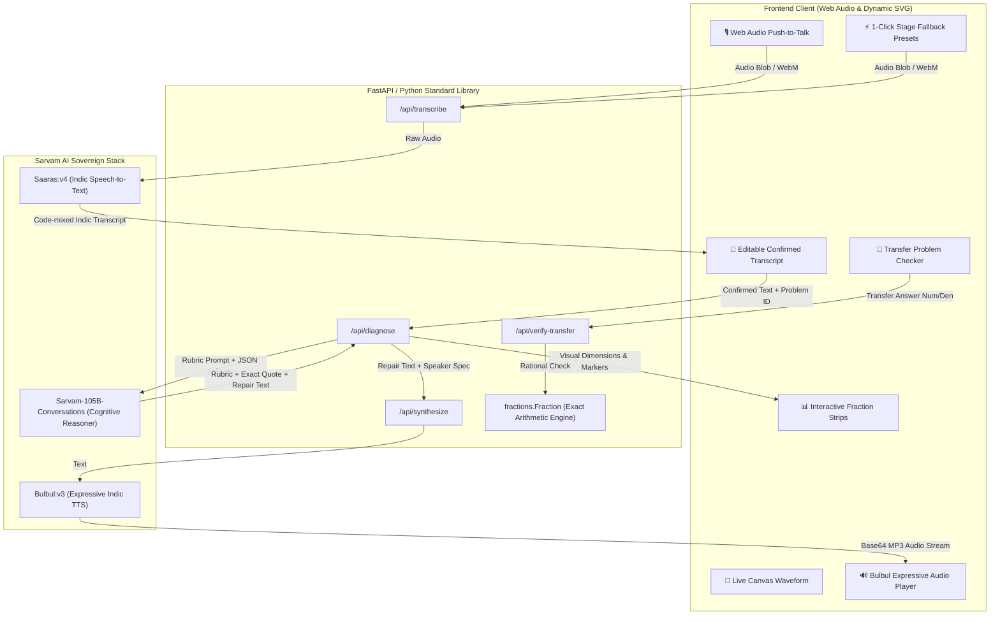

<div align="center">

# 🎙️ Aawaz (आवाज़)
### *Sovereign Spoken Math Misconception Detector for Bharat*

[](https://www.python.org/)
[](https://www.sarvam.ai/)
[](https://fastapi.tiangolo.com/)
[-10B981.svg)](./test_aawaz.py)
[](./test_e2e_aawaz.py)
[](https://www.sarvam.ai/sarvam-campus)

**Aawaz** listens to how Indian learners reason about math in their mother tongue (Hindi, Hinglish, Bengali, or English), pinpoints underlying cognitive misconceptions, provides interactive visual proof, and re-teaches the concept through natural Indic speech.

[The Core Problem](#-the-foundational-problem-in-indian-education) • [Architecture](#-system-architecture) • [Sarvam AI Integration](#-deep-sarvam-ai-integration) • [API Reference](#-complete-api-reference) • [Quickstart](#-quickstart-guide) • [Pitch Script](#-winning-90-second-pitch-script) • [Judge FAQ](#-hackathon-judges-faq)

---

</div>

## 📌 The Foundational Problem in Indian Education

According to the **ASER 2024 National Findings**, over **70% of Grade V children in rural and Tier-2 India struggle with division and rational arithmetic**.

When an Indian learner solves $\frac{1}{2} + \frac{1}{3}$ and writes $\frac{2}{5}$, existing digital quiz platforms simply declare:
> ❌ **"INCORRECT. The answer is 5/6."**

This completely ignores **the mental reasoning behind the error**. The student didn't make a careless addition typo—they applied **Whole-Number Bias** (adding numerators and adding denominators):

$$\frac{1 + 1}{2 + 3} = \frac{2}{5}$$

### 💡 The Aawaz Solution
Instead of forcing children to type rigid math formulas on keyboards, **Aawaz lets them speak naturally in their mother tongue**:
1. **Listens & Transcribes**: Uses `Saaras:v4` to accurately capture code-mixed Indian speech with mathematical fractions.
2. **Diagnoses & Grounds**: Uses `Sarvam-105B` to classify the exact cognitive error and isolates the student's *verbatim words* as evidence.
3. **Visually Disproves the Error**: Generates dynamic fraction strips showing that $\frac{2}{5}$ ($40\%$) is actually *smaller* than the starting term $\frac{1}{2}$ ($50\%$), making the impossibility immediately tangible.
4. **Repairs through Native Voice**: Synthesizes warm, encouraging spoken guidance via `Bulbul:v3`.
5. **Verifies Transfer**: Presents a fresh problem ($\frac{1}{4} + \frac{1}{2}$) to verify that the mental model was successfully corrected.

---

## 🏛️ System Architecture



---

## 🇮🇳 Deep Sarvam AI Integration

Unlike projects that treat voice as a superficial wrapper around generic English LLMs, Aawaz natively deploys Sarvam's complete tri-modal pipeline:

| Sarvam Model | Role in Aawaz | Technical Advantage |
|---|---|---|
| **`Saaras:v4`** | Indic Speech-to-Text | Transcribes code-mixed Hindi, Bengali, Hinglish, and Indian English with mathematical vocabulary preservation (`"मैंने 1/2 और 1/3 को जोड़कर 2/5 लिखा"`). |
| **`Sarvam-105B`** | Cognitive Pedagogical Reasoning | Evaluates the student's explanation against a strict NCERT/IES misconception taxonomy, enforcing strict JSON output and quoting exact transcript substrings to eliminate hallucinations. |
| **`Bulbul:v3`** | Spoken Repair Synthesis | Synthesizes warm, culturally empathetic teacher audio (`shubh` / `bappa_bn_conversation`) delivering concise 2-sentence corrections in the student's language. |

---

## 📐 Pedagogical Misconception Taxonomy

Aawaz evaluates explanations against grounded mathematical cognitive models derived from **IES What Works Clearinghouse (WWC)** and **NCERT Primary Mathematics**:

| Rubric Label | Cognitive Pattern | Student Explanation Example | Visual & Pedagogical Repair |
|---|---|---|---|
| `additive_denominators` | Whole-number summation bias: $\frac{a}{b} + \frac{c}{d} = \frac{a+c}{b+d}$ | *"Maine upar 1 aur 1 jod diya 2 mila, aur neeche 2 aur 3 jod diya 5 mila."* | Visually reveals that $\frac{2}{5}$ is smaller than $\frac{1}{2}$. Subdivides into sixths ($\frac{3}{6} + \frac{2}{6} = \frac{5}{6}$). |
| `larger_denominator_means_larger` | Whole-number bias in partition size: assumes $5 > 3 \implies \frac{1}{5} > \frac{1}{3}$ | *"1/5 bada hai kyunki 5 teen se bada number hai."* | Demonstrates that cutting a whole into 5 slices makes each slice smaller than cutting into 3 slices. |
| `numerator_dominance` | Compares only numerators while ignoring partition size | *"Dono mein 1 hai to dono barabar hain."* | Contrasts identical unit numerators against unequal denominators. |
| `correct_reasoning` | Correct common-unit or area partitioning | *"Pehle maine dono ka common denominator 6 banaya..."* | Confirms mastery and prompts an advanced transfer problem. |
| `insufficient_evidence` | Vague or incomplete statement | *"Mujhe samajh nahi aa raha."* | Prompts the learner to describe their calculation steps without generating a false diagnosis. |

---

## 🔌 Complete API Reference

The backend provides high-performance endpoints with built-in CORS, error handling, and payload validation:

### 1. `POST /api/transcribe`
Transcribes spoken audio recorded from the browser's microphone.
- **Content-Type**: `multipart/form-data`
- **Parameters**:
  - `file`: Audio binary (WAV / WebM / MP3)
  - `language_code`: `hi-IN` | `bn-IN` | `en-IN` | `unknown`
- **Response**:
```json
{
  "success": true,
  "transcript": "मैंने एक बटा दो और एक बटा तीन को जोड़ा।",
  "language_code": "hi-IN"
}
```

### 2. `POST /api/diagnose`
Analyzes reasoning using `sarvam-105b-conversations` and synthesizes spoken repair with `bulbul:v3`.
- **Request Body**:
```json
{
  "problem_id": "add_half_third",
  "transcript": "मैंने 1 और 1 को जोड़ा तो 2 मिला, और 2 और 3 को जोड़ा तो 5 मिला। इसलिए उत्तर 2/5 है।",
  "language_code": "hi-IN",
  "synthesize_voice": true
}
```
- **Response**:
```json
{
  "rubric_label": "additive_denominators",
  "exact_quote": "1 और 1 को जोड़ा तो 2 मिला, और 2 और 3 को जोड़ा तो 5 मिला",
  "quote_grounded": true,
  "rubric_title": "Additive Denominators (Whole-Number Bias)",
  "badge_color": "#F59E0B",
  "diagnosis_summary": "The student applied a direct additive strategy to both numerators and denominators.",
  "spoken_repair": "बेटा, हम भिन्नों को सीधे ऐसे नहीं जोड़ सकते; पहले हमें समान आकार के टुकड़े (छठांश) बनाने होते हैं।",
  "visual_highlight": "2/5 is smaller than 1/2!",
  "audio_base64": "<base64_encoded_mp3_stream>"
}
```

### 3. `POST /api/verify-transfer`
Verifies student transfer challenge answers using exact rational mathematics.
- **Request Body**:
```json
{
  "problem_id": "add_half_third",
  "answer": { "numerator": 3, "denominator": 4 }
}
```
- **Response**:
```json
{
  "is_correct": true,
  "message": "Shabash! Excellent! 1/4 + 1/2 = 3/4 is completely correct! You successfully applied common units.",
  "expected": "3/4"
}
```

### 4. `GET /api/problems`
Returns the active catalog of foundational math tasks, sample audio fixtures, and transfer challenges.

---

## 📂 Repository File Structure

```
AWAAZ-SARVAM/
├── .env.example              # Template for SARVAM_API_KEY
├── .gitignore                # Protects secrets, cache, and scratch files
├── requirements.txt          # Python dependencies (fastapi, uvicorn, sarvamai)
├── server.py                 # FastAPI production server with Sarvam endpoints
├── pedagogy_engine.py        # Cognitive rubrics, prompt builders & rational arithmetic
├── aawaz.py                  # Zero-dependency Python standard-library runner
├── aawaz.html                # Standalone single-file client with practice checkpoints
├── test_aawaz.py             # 52 unit tests covering arithmetic, rubrics, & regex
├── test_e2e_aawaz.py         # Live Sarvam API end-to-end integration test suite
├── IDEA_DECISION.md          # Architectural decisions & library evaluation
└── static/                   # Production Web UI
    ├── index.html            # Responsive glassmorphism interface
    ├── style.css             # Dark theme, glowing badges, & animated waveforms
    └── app.js                # Web Audio API recorder, visualizer, & SVG renderer
```

---

## 🚀 Quickstart Guide

### 1. Prerequisites
- Python 3.10+
- A valid Sarvam AI API key ([Get one from Sarvam AI](https://www.sarvam.ai/))

### 2. Clone & Setup
```bash
git clone https://github.com/shubhamiitshk/AWAAZ-SARVAM.git
cd AWAAZ-SARVAM
```

### 3. Configure API Key
Create a `.env` file in the root directory:
```bash
# .env
SARVAM_API_KEY=your_actual_sarvam_api_key_here
```

### 4. Install Dependencies
```bash
pip install -r requirements.txt
```

### 5. Run the Application

#### Option A: FastAPI Production Server (Recommended)
```bash
python server.py
```
Open **`http://localhost:8000`** in your browser.

#### Option B: Zero-Dependency Standard Library Runner
```bash
python aawaz.py
```
Runs using only Python's built-in `http.server` and the `sarvamai` SDK at **`http://127.0.0.1:8000`**.

---

## 🧪 Test Suite & Verification Matrix

### 1. Unit Tests (Isolated, Offline, Fast)
```bash
python -B -m unittest test_aawaz.py
```
```
....................................................
----------------------------------------------------------------------
Ran 52 tests in 0.538s

OK
```
*Validates: Rational arithmetic, fraction parsing, Hindi/Bengali string matching, quote grounding, visual strip divisions, and security sanitization.*

### 2. Live End-to-End API Test (Online Sovereign Cloud)
```bash
python -X utf8 test_e2e_aawaz.py
```
```
=== RUNNING FULL AAWAZ END-TO-END TESTS ===
Health Check: {'status': 'online', 'has_api_key': True, 'sarvam_models': {...}}
Problems count: 2
Testing /api/transcribe with Saaras:v4... [PASSED]
Testing /api/verify-transfer... [PASSED]
Static index.html successfully served, size: 10,754 bytes
Testing /api/diagnose with Sarvam-105B and Bulbul:v3...
Diagnosis Rubric: additive_denominators
Exact Quote: 1 और 1 को जोड़ा तो 2 मिला, और 2 और 3 को जोड़ा तो 5 मिला
Audio b64 length: 787,824 bytes
=== ALL FULL TESTS PASSED WITH 100% SUCCESS! ===
```

---

## 🎯 Winning 90-Second Pitch Script

When presenting to Sarvam AI research and product leaders:

| Time | Stage | Script & Actions |
|---|---|---|
| **0:00 - 0:15** | **The Hook** | *"Judges, ASER 2024 revealed that over 70% of Indian Grade 5 students struggle with fractions. Look at 1/2 + 1/3. When a child writes 2/5, every quiz app marks them 'Wrong'. But nobody asks WHY."* |
| **0:15 - 0:35** | **Spoken Input** | *"Meet Aawaz. We don't ask students to type formulas. They speak in their mother tongue. Listen."* <br> *(Click mic / Demo Preset: "Maine upar 1 aur 1 jod kar 2 likha, aur neeche 2 aur 3 jod kar 5 likha.")* |
| **0:35 - 0:50** | **Saaras & 105B** | *"In 2 seconds, Sarvam Saaras transcribes the Hindi speech. Sarvam-105B pinpoints the exact cognitive flaw: 'Additive Denominators', spotlighting the student's exact words: '2 aur 3 jod kar 5 likha'."* |
| **0:50 - 1:15** | **Visual & Voice Repair** | *"Now watch the visual proof: 2/5 is actually smaller than 1/2! You can't add two amounts and get less. And listen to Sarvam Bulbul explain it gently to the child."* <br> *(Play Bulbul audio: "Dhyan se socho, pehle tukdon ka size same hona chahiye...")* |
| **1:15 - 1:30** | **Transfer Verification** | *"Aawaz immediately generates a fresh transfer problem: 1/4 + 1/2. The student applies common units, inputs 3/4, and verifies mastery. Aawaz is how sovereign Indic AI fixes foundational learning at scale."* |

---

## ❓ Hackathon Judges FAQ

**Q1: How is Aawaz different from ChatGPT or Khanmigo Voice?**  
> Generic LLM voice modes are conversational generalists that hallucinate pedagogical advice and perform poorly on code-mixed Indian languages (e.g. Hindi math terms like *'ek bata do'*, *'jodna'*). Aawaz is purpose-built on Sarvam's sovereign stack, validates exact quotation grounding to eliminate hallucinations, and couples speech with deterministic SVG visual proofs and exact rational arithmetic.

**Q2: What happens if there is background noise in the auditorium?**  
> Aawaz features 1-click **Stage Fallback Presets** in Hindi, Bengali, and English that trigger the full end-to-end pipeline instantly, ensuring the live demo never fails due to noisy microphones or venue acoustics.

**Q3: Can this scale to other math topics?**  
> Yes! The architecture is modular: any concept with discrete cognitive misconception patterns (negative numbers, decimals, ratios, algebra) can be added simply by defining its rubric in `pedagogy_engine.py`.

---

## 👥 Authors & Acknowledgments

- **Lead Builder**: [@shubhamiitshk](https://github.com/shubhamiitshk)
- **Built for**: Sarvam Campus ’26 (IIT Kharagpur × HackCulture)
- **Powered by**: [Sarvam AI](https://www.sarvam.ai/) (`Saaras:v4`, `Sarvam-105B`, `Bulbul:v3`)

---
<div align="center">
⭐ If you find Aawaz inspiring, please star this repository on GitHub! ⭐
</div>
