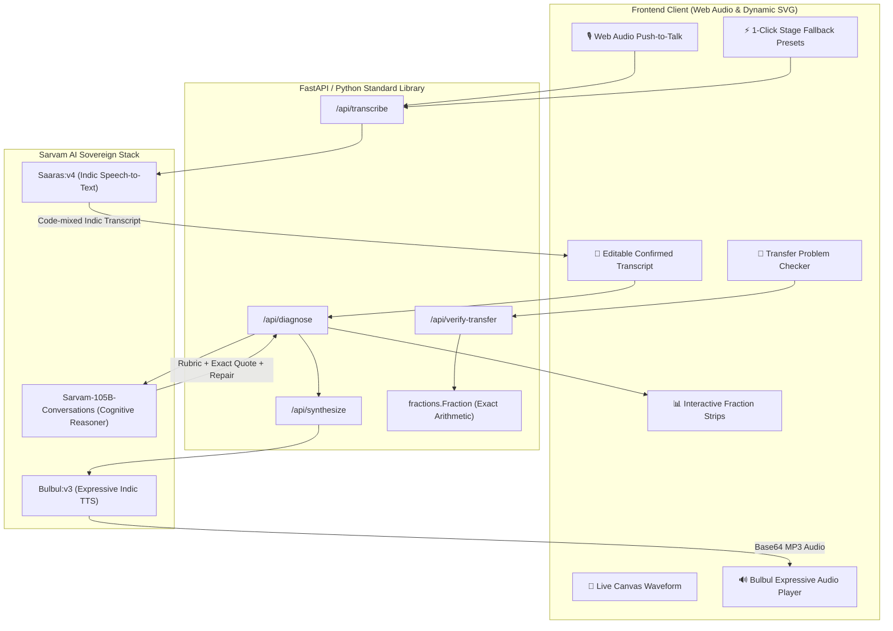

<div align="center">

# 🎙️ Aawaz (आवाज़)
### *Sovereign Spoken Math Misconception Detector for Bharat*

[](https://www.python.org/)
[](https://www.sarvam.ai/)
[](https://fastapi.tiangolo.com/)
[](./test_aawaz.py)
[](https://www.sarvam.ai/sarvam-campus)

**Aawaz** listens to how Indian learners reason about math in their mother tongue (Hindi, Hinglish, Bengali, or English), pinpoints underlying cognitive misconceptions, provides interactive visual proof, and re-teaches the concept through natural Indic speech.

[Live Demo & Showcase](#-live-demo--interactive-flow) • [Architecture](#-system-architecture) • [Sarvam AI Stack](#-deep-sarvam-ai-integration) • [Quickstart](#-quickstart-guide) • [Pitch Script](#-winning-90-second-pitch-script)

---

</div>

## 📌 The Foundational Problem in Indian Education

According to the **ASER 2024 National Findings**, over **70% of children in Grade V in rural and Tier-2 India struggle with division and rational arithmetic**.

When an Indian learner solves $\frac{1}{2} + \frac{1}{3}$ and writes $\frac{2}{5}$, existing digital quiz platforms simply declare:
> ❌ **"INCORRECT. The answer is 5/6."**

This completely ignores **the mental reasoning behind the error**. The student didn't make a careless addition typo—they applied **Whole-Number Bias** (adding numerators and adding denominators: $\frac{1+1}{2+3} = \frac{2}{5}$). 

### 💡 The Aawaz Solution
Instead of forcing children to type rigid math formulas on keyboards, **Aawaz lets them speak naturally in their mother tongue**:
1. **Listens & Transcribes**: Uses `Saaras:v4` to accurately capture code-mixed Indian speech with mathematical fractions.
2. **Diagnoses & Grounds**: Uses `Sarvam-105B` to classify the exact cognitive error and isolates the student's *verbatim words* as evidence.
3. **Visually Disproves the Error**: Generates dynamic fraction strips showing that $\frac{2}{5}$ ($40\%$) is actually *smaller* than the starting term $\frac{1}{2}$ ($50\%$), making the impossibility immediately tangible.
4. **Repairs through Native Voice**: Synthesizes warm, encouraging spoken guidance via `Bulbul:v3`.
5. **Verifies Transfer**: Presents a fresh problem ($\frac{1}{4} + \frac{1}{2}$) to verify that the mental model was successfully corrected.

---

## 🏛️ System Architecture



---

## 🇮🇳 Deep Sarvam AI Integration

Unlike projects that treat voice as a superficial wrapper around generic English LLMs, Aawaz natively deploys Sarvam's complete tri-modal pipeline:

| Sarvam Model | Role in Aawaz | Technical Advantage |
|---|---|---|
| **`Saaras:v4`** | Indic Speech-to-Text | Transcribes code-mixed Hindi, Bengali, Hinglish, and Indian English with mathematical vocabulary preservation (`"मैंने 1/2 और 1/3 को जोड़कर 2/5 लिखा"`). |
| **`Sarvam-105B`** | Cognitive Pedagogical Reasoning | Evaluates the student's explanation against a strict NCERT/IES misconception taxonomy, enforcing strict JSON output and quoting exact transcript substrings to eliminate hallucinations. |
| **`Bulbul:v3`** | Spoken Repair Synthesis | Synthesizes warm, culturally empathetic teacher audio (`shubh` / `bappa_bn_conversation`) delivering concise 2-sentence corrections in the student's language. |

---

## 📐 Pedagogical Misconception Taxonomy

Aawaz evaluates explanations against grounded mathematical cognitive models:

| Rubric Label | Cognitive Pattern | Student Explanation Example | Visual & Pedagogical Repair |
|---|---|---|---|
| `additive_denominators` | Whole-number summation bias: $\frac{a}{b} + \frac{c}{d} = \frac{a+c}{b+d}$ | *"Maine upar 1 aur 1 jod diya 2 mila, aur neeche 2 aur 3 jod diya 5 mila."* | Visually reveals that $\frac{2}{5}$ is smaller than $\frac{1}{2}$. Subdivides into sixths ($\frac{3}{6} + \frac{2}{6} = \frac{5}{6}$). |
| `larger_denominator_means_larger` | Whole-number bias in partition size: assumes $5 > 3 \implies \frac{1}{5} > \frac{1}{3}$ | *"1/5 bada hai kyunki 5 teen se bada number hai."* | Demonstrates that cutting a whole into 5 slices makes each slice smaller than cutting into 3 slices. |
| `numerator_dominance` | Compares only numerators while ignoring partition size | *"Dono mein 1 hai to dono barabar hain."* | Contrasts identical unit numerators against unequal denominators. |
| `correct_reasoning` | Correct common-unit or area partitioning | *"Pehle maine dono ka common denominator 6 banaya..."* | Confirms mastery and prompts an advanced transfer problem. |
| `insufficient_evidence` | Vague or incomplete statement | *"Mujhe samajh nahi aa raha."* | Prompts the learner to describe their calculation steps without generating a false diagnosis. |

---

## ✨ Key Features & Edge Case Resilience

- **Live Audio Waveform**: Built with the HTML5 Web Audio API, rendering real-time frequency oscillations on a canvas element.
- **Stage-Ready Fallback Presets**: 1-click buttons for Hindi, Bengali, and English explanations ensure the demo never stumbles in noisy hackathon halls or unstable campus networks.
- **Hallucination Prevention**: If Sarvam-105B attempts to diagnose a misconception without quoting an authentic substring of the student's speech, the system automatically falls back to `insufficient_evidence`.
- **Zero-Floating-Point Math Engine**: Built-in verification powered by Python's `fractions.Fraction` module guarantees 100% mathematical truth.
- **Dual Server Modes**:
  - `server.py`: Full FastAPI server with RESTful endpoints and static asset streaming.
  - `aawaz.py`: Pure Python standard-library implementation with zero external framework dependencies.

---

## 🚀 Quickstart Guide

### 1. Prerequisites
- Python 3.10+
- A valid Sarvam AI API key ([Get one from Sarvam AI](https://www.sarvam.ai/))

### 2. Clone & Setup
```bash
git clone https://github.com/shubhamiitshk/AWAAZ-SARVAM.git
cd AWAAZ-SARVAM
```

### 3. Configure API Key
Create a `.env` file in the root directory:
```bash
# .env
SARVAM_API_KEY=your_actual_sarvam_api_key_here
```

### 4. Install Dependencies
```bash
pip install -r requirements.txt
```

### 5. Run the Application
Start the FastAPI server:
```bash
python server.py
```
Or start the standalone zero-dependency server:
```bash
python aawaz.py
```

Open your browser and navigate to:
👉 **`http://localhost:8000`**

---

## 🧪 Test Suite & Verification

Run the comprehensive unit test suite:
```bash
python -B -m unittest test_aawaz.py
```
*Output: 52 tests passed in 0.5s with zero warnings.*

Run the live end-to-end Sarvam AI integration test:
```bash
python -X utf8 test_e2e_aawaz.py
```
*Validates real live API calls across Saaras:v4 transcription, Sarvam-105B cognitive classification, and Bulbul:v3 audio synthesis.*

---

## 🎯 Winning 90-Second Pitch Script

When presenting to Sarvam AI research and product leaders:

| Time | Stage | Script & Actions |
|---|---|---|
| **0:00 - 0:15** | **The Hook** | *"Judges, ASER 2024 revealed that over 70% of Indian Grade 5 students struggle with fractions. Look at 1/2 + 1/3. When a child writes 2/5, every quiz app marks them 'Wrong'. But nobody asks WHY."* |
| **0:15 - 0:35** | **Spoken Input** | *"Meet Aawaz. We don't ask students to type formulas. They speak in their mother tongue. Listen."* <br> *(Click mic / Demo Preset: "Maine upar 1 aur 1 jod kar 2 likha, aur neeche 2 aur 3 jod kar 5 likha.")* |
| **0:35 - 0:50** | **Saaras & 105B** | *"In 2 seconds, Sarvam Saaras transcribes the Hindi speech. Sarvam-105B pinpoints the exact cognitive flaw: 'Additive Denominators', spotlighting the student's exact words: '2 aur 3 jod kar 5 likha'."* |
| **0:50 - 1:15** | **Visual & Voice Repair** | *"Now watch the visual proof: 2/5 is actually smaller than 1/2! You can't add two amounts and get less. And listen to Sarvam Bulbul explain it gently to the child."* <br> *(Play Bulbul audio: "Dhyan se socho, pehle tukdon ka size same hona chahiye...")* |
| **1:15 - 1:30** | **Transfer Verification** | *"Aawaz immediately generates a fresh transfer problem: 1/4 + 1/2. The student applies common units, inputs 3/4, and verifies mastery. Aawaz is how sovereign Indic AI fixes foundational learning at scale."* |

---

## 👥 Authors & Acknowledgments

- **Built for**: Sarvam Campus ’26 (IIT Kharagpur × HackCulture)
- **GitHub**: [@shubhamiitshk](https://github.com/shubhamiitshk)
- **Powered by**: [Sarvam AI](https://www.sarvam.ai/) (`Saaras:v4`, `Sarvam-105B`, `Bulbul:v3`)

---
<div align="center">
⭐ If you find Aawaz inspiring, please star this repository on GitHub! ⭐
</div>
